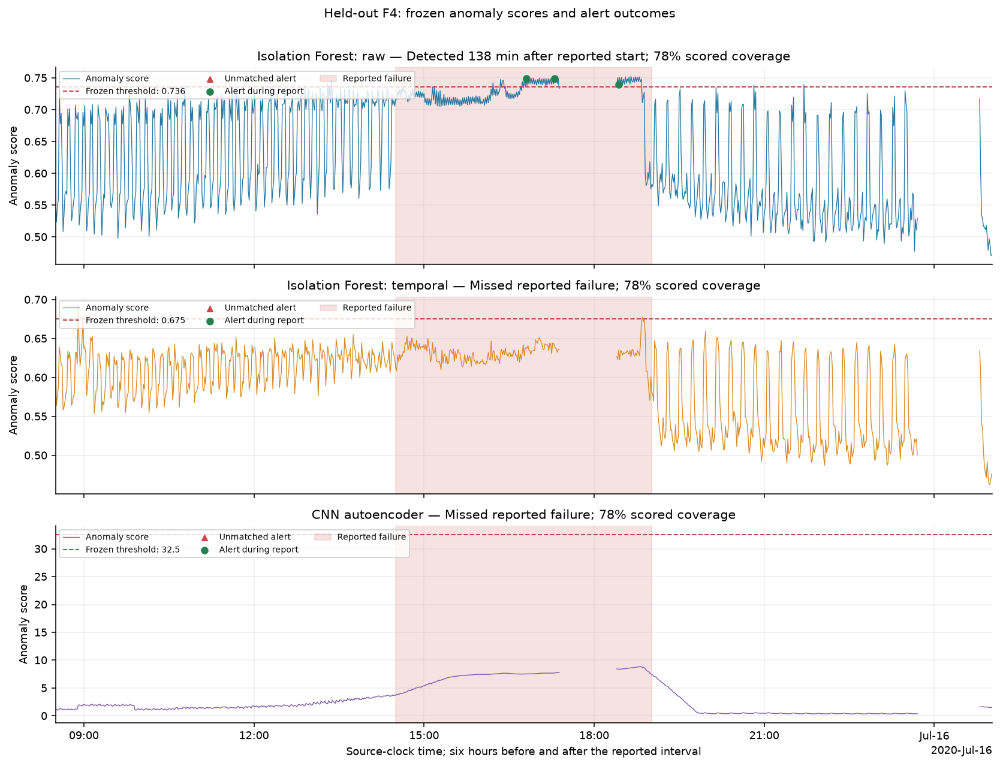

# MetroPT-3 anomaly detection

Compare Isolation Forest and a CNN autoencoder on railway air-compressor
telemetry, with chronological evaluation and an MLflow/Databricks batch pipeline.

[MetroPT-3](https://archive.ics.uci.edu/dataset/791/metropt+3+dataset) contains
1.5 million sensor readings and four reported air-leak events. Models train on
the initial, assumed-normal month. Failure reports guide validation and evaluation;
they are not training targets. Unreported periods remain unknown.

## Results

| Model | Input | Validation events detected | Validation unmatched alerts/day | Test events detected |
|---|---|---:|---:|---:|
| Isolation Forest | 15 sensors | 3/3 | 0.961 | 1/1 |
| Isolation Forest, temporal | 148 sensor and rolling features | 2/3 | 0.910 | 0/1 |
| CNN autoencoder | 60-step sensor sequences | 3/3 | 0.628 | 0/1 |

Validation selected the CNN because it detected all three events with fewer
unmatched alerts. Its frozen threshold was **32.52**, while the highest test
score was **11.29**. It missed July's failure, so promotion is blocked. Raw
Isolation Forest detected that event **138 minutes after onset**, not in advance.
The test result was not used to change models or thresholds.



See the [comparison](reports/model_comparison.md) for ranking metrics, coverage,
and limitations. One test event is insufficient to establish general performance.

## Run locally

Use Python 3.12 and [uv](https://docs.astral.sh/uv/):

```bash
uv sync --frozen
uv run metropt download
uv run metropt prepare
uv run pytest
uv run metropt run --output reports/runs/benchmark
```

`uv.lock` pins dependencies. [Configuration](configs/experiments.yaml) fixes
seeds, dates, features, and alert rules. Downloaded data and fitted models stay
outside Git. Each run writes detailed scores, models, and MLflow records;
`reports/` contains the published tables and figures.

```bash
uv run metropt predict \
  --model reports/runs/benchmark/selected_model.joblib \
  --input data/processed/observations.parquet \
  --output reports/runs/replay_predictions.parquet
uv run mlflow ui --backend-store-uri sqlite:///reports/mlflow.db --port 5001
```

Prediction uses the supplied history. Reproducing test decisions requires the
same replay start as the test partition; see the [inference contract](docs/operations.md).

## Evaluation and delivery

- February: normal-only training and a separate early-stopping period.
- March–June 14: threshold calibration and model selection using three events.
- June 15–September 1: final evaluation using the July event.
- Causal minute snapshots, train-only scaling, and windows that never cross gaps
  or split boundaries. All models score the same eligible timestamps.
- A shared ceiling of one unmatched alert/day, two-minute persistence, and
  30-minute cooldown. Unmatched alerts are not confirmed false positives.

CI runs tests and builds a wheel. Databricks jobs load versioned Delta data,
train/register a candidate, score batches, monitor inputs and outputs, and
promote explicitly reviewed versions. **Databricks execution has not been verified
without a workspace.** AutoML and Model Serving are not implemented; inference
requires ordered history rather than independent single-row requests.

[Data and split notes](docs/data.md) · [Databricks setup](databricks/README.md) ·
[Operations](docs/operations.md) · [Project walkthrough](docs/interview.md)

Dataset: Davari, Veloso, Ribeiro, and Gama (2021),
[DOI: 10.24432/C5VW3R](https://doi.org/10.24432/C5VW3R), CC BY 4.0.
